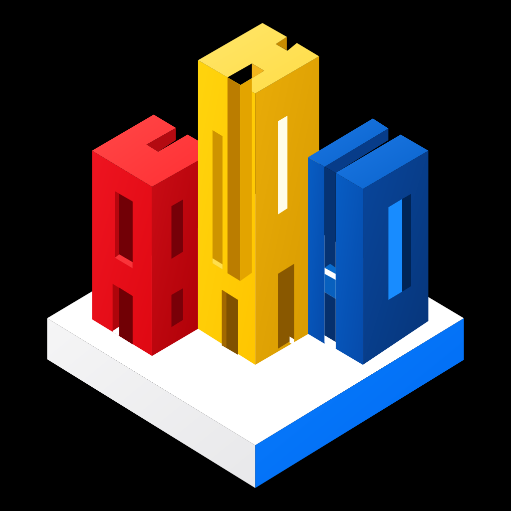
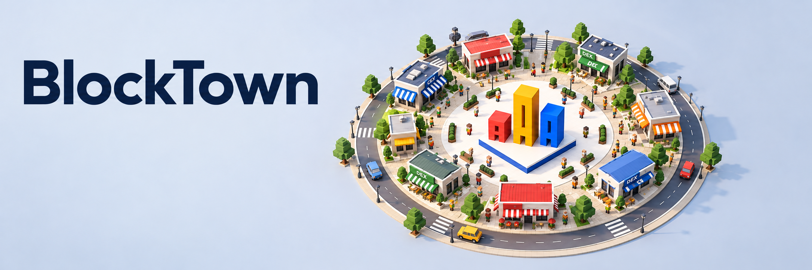
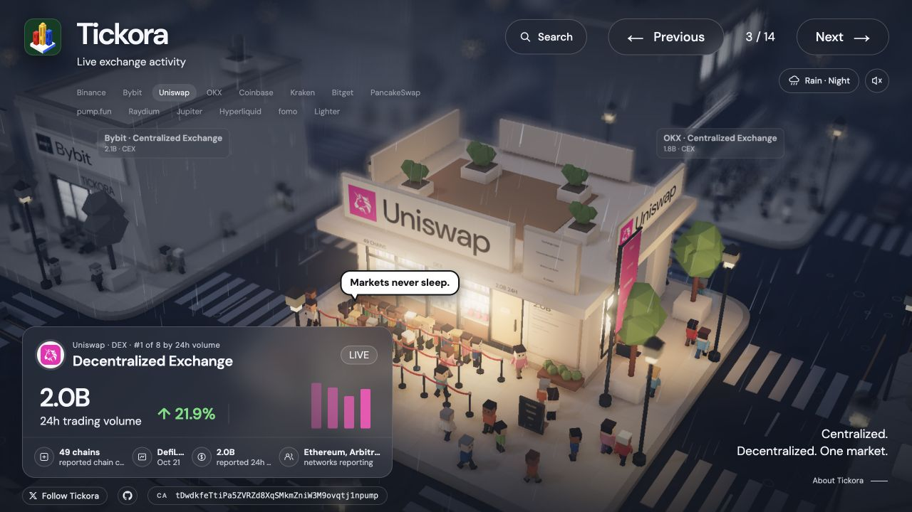
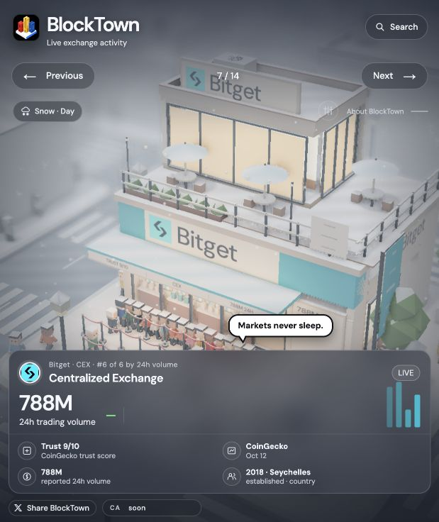
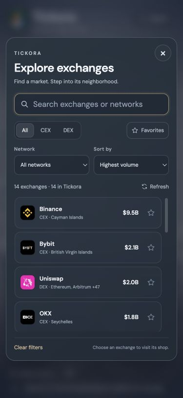

<div align="center">
  
  <h1>BlockTown</h1>
  <p>A miniature town, shaped by exchange activity.</p>
  <p>Explore 14 markets, find your favorites, and give the neighborhood a different atmosphere.</p>
  <p><a href="https://blocktown.fun/"><strong>Visit BlockTown ↗</strong></a></p>
  <p>
    
    
    
    
  </p>
</div>



BlockTown turns public, reported trading activity into a browser-based 3D neighborhood. Exchanges become distinct storefronts, while volume informs the crowds around them. The experience combines market discovery with a small, animated world of shop windows, rooftops, trees, traffic, rain, and snow.

The app runs as a static website: native JavaScript modules, locally vendored Three.js, and public data requested directly by the browser. No application backend, API keys, or build step are required.

## Features

- **14 exchange storefronts** with volume cards, reported metadata, and crowd activity that updates with the data.
- **Useful search** across names, IDs, known English and Chinese aliases, exchange types, networks, and countries. Matching ignores case and punctuation.
- **Focused discovery** with CEX/DEX and network filters, volume/name/24-hour-change sorting, result counts, and a clear empty state.
- **Personal favorites** saved in the browser, with a dedicated collection filter and keyboard focus retained after updates.
- **Direct 3D navigation** through building picking, store tabs, previous/next controls, drag-to-orbit, wheel zoom, and touch pinch-to-zoom.
- **Weather and light** with Day, Night, or Auto time; Clear, Sunny, Rain, or Snow scenes; adjustable intensity, wet surfaces, rain ripples, and snow that gradually accumulates on roofs and streets, then melts when the weather changes.
- **Scene playback** with 1×, 8×, 24×, and 48× crowd/traffic timelapse, pause, motion exposure, and a macro depth-of-field lens.
- **Save and share** the current scene as a PNG or share a URL containing the selected exchange, hour, and weather. A 2D exchange map keeps browsing available when WebGL cannot initialize.

## In the town

<table>
  <tr>
    <th>Rain</th>
    <th>Snow</th>
    <th>Mobile discovery</th>
  </tr>
  <tr>
    <td align="center"></td>
    <td align="center"></td>
    <td align="center"></td>
  </tr>
</table>

## Quick start

Use **Node.js 22 or later**. The runtime dependencies are already included in `vendor/`; no install step is needed.

```sh
git clone https://github.com/theovarne/BlockTown.git
cd BlockTown
npm run dev
```

Open [http://localhost:8000](http://localhost:8000).

Alternatively, serve the repository root with Python:

```sh
python3 -m http.server 8000
```

Serve the files over HTTP so the browser can load modules and the bundled JSON snapshot.

### Commands

| Command | Purpose |
| --- | --- |
| `npm run dev` | Start the local static server on port 8000. |
| `npm run check` | Check source syntax and project consistency. |
| `npm test` | Run the Node test suite. |

## Architecture

| File or directory | Responsibility |
| --- | --- |
| `index.html` | Page structure, native search/weather dialogs, controls, and social metadata. |
| `styles.css` | Responsive glass overlays, result rows, dialog layouts, and the map view. |
| `app.js` | Application state, scene/UI coordination, keyboard and pointer controls, refresh scheduling, exports, and share URLs. |
| `data.js` | Venue registry, public-feed requests, normalization, measured-volume ranking, snapshot fallback, and browser cache. |
| `explore.js` | Pure search, alias matching, network options, filtering, and deterministic sorting. |
| `explore-ui.js` | Search results, native dialog interactions, favorites, and focus management. |
| `scene.js` | Procedural buildings, instanced citizens, traffic, camera movement, raycast picking, and image capture. |
| `appearance.js` | District materials, miniature lens, day/night lighting, and weather-adjusted appearance. |
| `weather.js` | GPU rain, snowfall, ground ripples, particle budgets, and resource cleanup. |
| `snow-cover.js` | Time-based roof and street snow accumulation, intensity scaling, gradual melting, and pause behavior. |
| `assets/` | Exchange marks, BlockTown artwork/icons, the local font, and the dated market snapshot. |
| `vendor/` | Three.js and the selected rendering/postprocessing add-ons. |
| `scripts/` | Local static server, syntax checks, and project consistency checks. |
| `tests/` | Node tests for search/filter behavior and market-data cache integrity. |

Favorites, the selected exchange, sky preferences, and eligible market observations are stored in `localStorage`. Weather is controlled locally in the scene.

## Market data

**CoinGecko** supplies centralized-exchange activity and the BTC/USD conversion used for reported BTC-denominated volumes. **DefiLlama** supplies decentralized-exchange volume and reported network coverage.

The town opens from `assets/data/exchanges.json`, then requests fresh public feeds in the background. Refreshes run every **five minutes**, and the explorer also offers a manual refresh. When a request fails, the app preserves newer measured observations or uses the dated snapshot. Eligible browser-cache observations retain their source timestamps; cached or snapshot values are not relabeled as live.

`LIVE` identifies a successful current feed. Source timestamps are available in the interface, and unreported values remain absent rather than being fabricated. Trend bars use the observations actually supplied by the data layer.

Ranks compare the tracked venues **within their CEX or DEX group**. They are not a global ranking of every exchange. The registry currently contains:

| Group | Exchanges |
| --- | --- |
| **CEX · 6** | Binance, OKX, Bybit, Coinbase, Kraken, Bitget |
| **DEX · 8** | Uniswap, PancakeSwap, pump.fun, Raydium, Hyperliquid, fomo, Jupiter, Lighter |

## Controls

| Action | Control |
| --- | --- |
| Open search | Search button or <kbd>⌘ K</kbd> / <kbd>Ctrl K</kbd> |
| Visit an exchange | Click its building, tab, or search result |
| Previous / next exchange | <kbd>←</kbd> / <kbd>→</kbd> |
| Orbit the selected storefront | Drag |
| Zoom | Scroll wheel or two-finger pinch |
| Reset the camera | <kbd>R</kbd> |
| 1× / 8× / 24× / 48× timelapse | <kbd>1</kbd> / <kbd>2</kbd> / <kbd>3</kbd> / <kbd>4</kbd> |
| Pause / resume | <kbd>Space</kbd> |
| Decrease / increase motion exposure | <kbd>[</kbd> / <kbd>]</kbd> |
| Toggle automatic day/night cycling | <kbd>D</kbd> or <kbd>Shift D</kbd> |
| Step back / forward one hour | <kbd>,</kbd> / <kbd>.</kbd>; switches to manual time |
| Show / hide the interface | <kbd>/</kbd> |
| Show / hide playback controls | <kbd>⌘ '</kbd> / <kbd>Ctrl '</kbd>, or the compact controls button on smaller screens |
| Set weather and time | The weather/light button near the navigation |
| Save a PNG | About BlockTown → Save scene image |

In search, <kbd>Enter</kbd> visits the first match and <kbd>↓</kbd> moves focus into the results. Use <kbd>↑</kbd>/<kbd>↓</kbd>, <kbd>Home</kbd>, and <kbd>End</kbd> to navigate result buttons. Store tabs also support arrow keys, Home, and End. Native dialogs close with <kbd>Escape</kbd>; scene shortcuts stay inactive while a dialog is open.

## Shareable views

For example, visit Uniswap on a rainy night:

```text
https://blocktown.fun/?exchange=uniswap&hour=21&cycle=0&weather=rain&intensity=0.65
```

| Parameter | Value |
| --- | --- |
| `exchange` | Venue ID from the registry, such as `binance`, `uniswap`, or `pumpfun`. |
| `hour` | Decimal hour in the 24-hour cycle, such as `13` or `21`. |
| `cycle` | `1` for automatic cycling; `0` to keep the selected hour. |
| `weather` | `clear`, `sunny`, `rain`, or `snow`. |
| `intensity` | Scene intensity from `0.2` to `1`. |

The share action captures the current hour and uses `cycle=0` so the recipient opens the same time of day.

## Deploy to Vercel

Import this repository into Vercel and serve the static repository root:

| Setting | Value |
| --- | --- |
| Framework preset | **Other** |
| Build command | Leave empty |
| Output directory | Repository root (`.`), configured in `vercel.json` |
| Environment variables | None required |

The site uses browser-side public-feed requests. Deployment does not require a backend service or private credentials.

## Customize

- **Venues:** edit the `venues` registry in `data.js` and add the matching exchange asset in `assets/`. Adjust feed aliases and parent-protocol mappings there when necessary.
- **Search:** extend `aliasGroups` in `explore.js` for alternative names or spellings.
- **The town:** change storefront styles, geometry, street props, and layout in `scene.js`; tune materials, lighting, and the macro lens in `appearance.js`.
- **Weather:** tune rain, snow, and ripple budgets in `weather.js`. The renderer uses smaller particle limits on mobile layouts.
- **Branding:** update `assets/blocktown.svg`, keeping the raster icons, `site.webmanifest`, and social card in sync.

## Attribution and third-party notices

The original 3D town concept was inspired by [Ryan Sael](https://sael.net/). Three.js and its bundled add-ons retain their MIT license in [`vendor/LICENSE`](vendor/LICENSE). DM Sans is bundled under the SIL Open Font License. Exchange names and marks belong to their respective owners.

See [`THIRD_PARTY_NOTICES.md`](THIRD_PARTY_NOTICES.md) for third-party license texts and asset notices.
